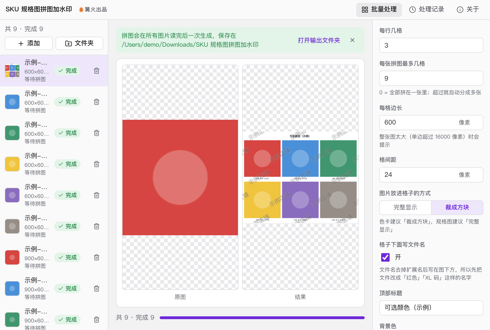

# SKU 规格图拼图加水印

> 篝火出品 · 收录于篝火 App 应用区

色卡、规格图自动排版加水印



## 下载

到 [Releases](https://github.com/campfire-code/sku-image-composer/releases/latest) 下载对应安装包：

| 电脑 | 文件 |
|---|---|
| Windows 10 / 11 | `sku-image-composer_版本号_windows-x64-setup.exe` |
| Mac（Apple 芯片） | `sku-image-composer_版本号_mac-arm64.dmg` |
| Mac（Intel 芯片） | `sku-image-composer_版本号_mac-x64.dmg` |

第一次打开：
- **Windows**：如果弹出「Windows 已保护你的电脑」，点「更多信息」→「仍要运行」。
- **Mac**：如果提示「无法验证开发者」，打开「系统设置 → 隐私与安全性」，在下方点「仍要打开」。

## 怎么用

所有处理都在你电脑上完成，图片不上传、不联网。

1. 先把要拼的图片改成有意义的名字，比如 `01-红色.png`、`02-蓝色.png`。拼图按列表顺序排，每格下面写的就是文件名（去掉扩展名）。
2. 把规格图、色卡一起拖进窗口（支持 JPG、PNG、WebP、BMP、GIF）。列表顺序就是拼图顺序。
3. 设置版式：每行几格、每张拼图最多几格（超过会自动分成多张）、每格边长、间距。色卡建议「裁成方块」，规格图建议「完整显示」。
4. 加水印：选「文字」填店铺名，或选「图片」挑一张透明背景的 PNG；可选位置（四角、正中、斜着铺满）、不透明度和宽度。水印加在整张拼图上。
5. 选输出格式（PNG 或 JPG）和保存位置，点「开始处理」。先逐张检查图片能不能读出来，全部读完后一次生成，结果是 `拼图-01.png`、`拼图-02.png`……

注意：
- 某张图读不出来（损坏、格式不支持）会在列表里标红，其余图照常拼。
- 整张拼图单边超过 16000 像素时不会生成，会提示你减少列数、每张格数或缩小每格尺寸。这个上限是本工具自己定的保守值，实际取决于系统网页引擎，未逐平台核实。
- 水印只是视觉标记，不能防止别人裁掉或去除。
- 本工具不判断图片版权，使用别人的图片和水印素材前请自行确认授权。

## 验收用例

示例图片都是用脚本画的色块和形状，文件名带「示例」，不含真实品牌。

| 操作 | 应得到 |
|---|---|
| 把 `samples/` 里 6 张 `示例-色卡-*.png` 拖进来；每行 3 格、完整显示、写文件名开、水印选「文字」填「示例店铺」、位置右下角、格式 PNG，点「开始处理」 | 保存位置出现 `拼图-01.png`：2 行 3 列，每格 600×600，整图 1896×1384；每格下方依次写「示例-色卡-01朱红」……；右下角有半透明「示例店铺」 |
| 在上面基础上再拖入 3 张 `示例-规格图-*.png`（900×600 横图），「每张最多几格」改成 4，「图片放进格子的方式」选「裁成方块」 | 共 9 张图分成 3 张：`拼图-01.png`（4 格）、`拼图-02.png`（4 格）、`拼图-03.png`（1 格），横图被裁成方块、左右两边各裁掉一部分 |
| 改成「完整显示」再处理一次 | 横图完整显示，格子上下留出浅色空白 |
| 水印选「图片」，挑 `samples/示例-水印图.png`，位置选「斜着铺满」，不透明度 30 | 每张拼图上斜着铺满同一个圆环图案 |
| 水印选「文字」但把文字清空，点「开始处理」 | 每张图都报错「水印选了「文字」，但还没填水印文字」，不生成文件 |
| 把「每行几格」设为 1、每张格数设为 0，拖入 20 张以上图片，每格边长 1600 | 提示整张图超过 16000 像素，不生成文件 |

## 自己编译

需要 Node.js 22、pnpm、Rust。

```bash
pnpm install
pnpm test          # 单元测试
pnpm tauri dev     # 开发运行
pnpm tauri build   # 打包
```

界面框架在 `src/kit`（所有 campfire-code 工具共用），本工具的逻辑在 `src/tool`。

## 归属

本工具由**篝火**出品，是篝火 App 应用区收录的开源工具之一，由篝火（GitHub 组织 [campfire-code](https://github.com/campfire-code)）维护与更新。全部工具的目录见 [toolkit-hub](https://github.com/campfire-code/toolkit-hub)。

## 许可证

MIT，版权方为篝火（campfire-code）。
